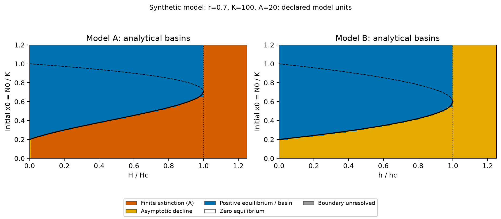
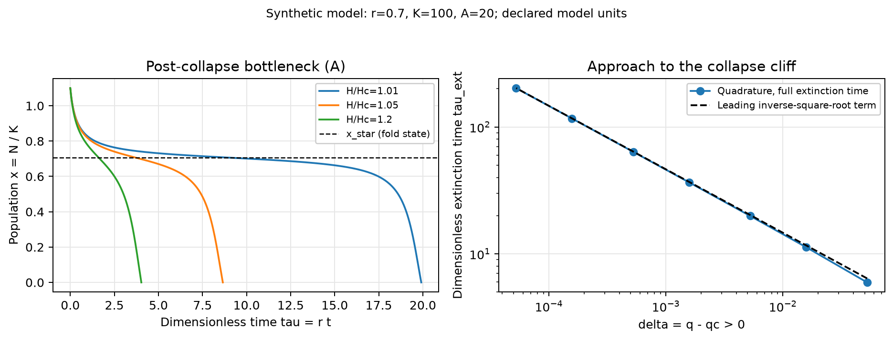
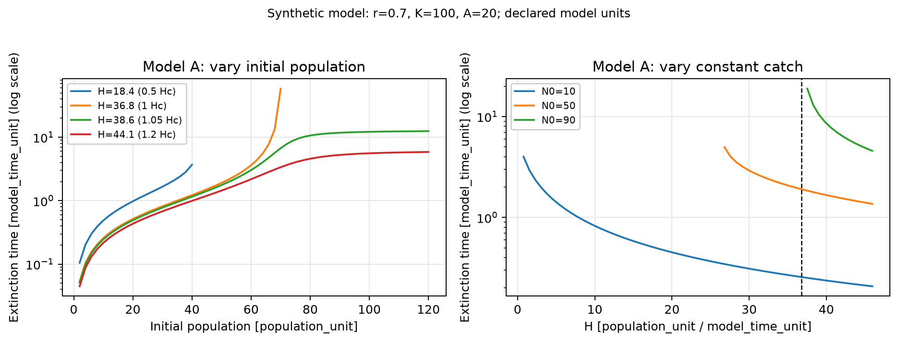

# WP03 explained, from the beginning

**For Devam and anyone joining the project.** You do not need to know PINNs to understand or present WP03. You need basic derivatives, signs of functions and definite integrals. We build those ideas into the population model below.

This is a learning guide for the implemented work on `wp03/collapse-analysis`, reviewed in [PR #4](https://github.com/devam2006/mm-allee-harvesting/pull/4). It explains the code and the mathematics. Reading it is separate from doing your own review or practising the presentation.

The examples are **synthetic**: we choose the parameters and calculate what the assumed model predicts. They are not measurements of a real fish population.

## Reading map

1. [The question WP03 answers](#1-the-question-wp03-answers)
2. [Population, growth and a derivative](#2-population-growth-and-a-derivative)
3. [Why the Allee effect changes the model](#3-why-the-allee-effect-changes-the-model)
4. [The two harvesting rules](#4-the-two-harvesting-rules)
5. [Making the equations smaller](#5-making-the-equations-smaller)
6. [Equilibria and stability](#6-equilibria-and-stability)
7. [Deriving the harvesting thresholds](#7-deriving-the-harvesting-thresholds)
8. [Basins and critical initial population](#8-basins-and-critical-initial-population)
9. [Finite versus asymptotic extinction](#9-finite-versus-asymptotic-extinction)
10. [Calculating extinction time](#10-calculating-extinction-time)
11. [What RK45 actually does](#11-what-rk45-actually-does)
12. [Why collapse can take a long time](#12-why-collapse-can-take-a-long-time)
13. [Sensitivity and maximum sustainable yield](#13-sensitivity-and-maximum-sustainable-yield)
14. [The clean data given to WP04 and WP05](#14-the-clean-data-given-to-wp04-and-wp05)
15. [How the code fits together](#15-how-the-code-fits-together)
16. [Reading our figures and tables](#16-reading-our-figures-and-tables)
17. [Running the work yourself](#17-running-the-work-yourself)
18. [What the tests establish](#18-what-the-tests-establish)
19. [What the recheck found](#19-what-the-recheck-found)
20. [Presentation and questions](#20-presentation-and-questions)
21. [What remains for the group](#21-what-remains-for-the-group)
22. [Sources and further reading](#22-sources-and-further-reading)

If an equation feels difficult, read the sentence immediately after it. The equation and the sentence describe the same idea.

## 1. The question WP03 answers

Suppose a population is harvested. We want to know:

- How much harvesting can its growth support?
- Does the starting population matter?
- If the population collapses, when does it reach zero?
- Can a long period of slow decline hide an eventual collapse?

WP03 derives the boundaries between these outcomes, calculates extinction times, and supplies reliable numerical trajectories for the PINN tasks.

We also implemented two optional extensions: how the boundaries depend on the parameters, and how maximum sustainable yield differs from maximum harvesting effort.

WP03 does not train a PINN. WP04 handles forward PINNs; WP05 handles noisy observations, inverse fitting and held-out validation. WP02 handles the up/down harvesting and restocking experiments.

## 2. Population, growth and a derivative

Write the population as $N(t)$. It might represent a biomass rather than a literal integer count. We treat it as a continuous quantity.

The derivative

$$\frac{dN}{dt}$$

is the rate at which the population changes. A value of $+3$ means an increase of about three population units per time unit at that moment. A value of $-3$ means a decrease.

Our starting point from class is logistic growth:

$$\frac{dN}{dt}=rN\left(1-\frac{N}{K}\right).$$

Here $r>0$ sets the time scale of growth. $K$ is the carrying capacity: the population level where crowding stops net growth in this simple model.

For $0<N<K$, logistic growth is positive. For $N>K$, it is negative. This means that a small positive population can grow in the unharvested logistic model.

That last assumption is what we change.

## 3. Why the Allee effect changes the model

Some populations struggle when there are too few individuals. Our model represents that possibility with a threshold $A$, where $0<A<K$.

We use the natural-growth function

$$g(N)=rN\left(1-\frac{N}{K}\right)\left(\frac{N}{A}-1\right).$$

The new factor $N/A-1$ changes sign at $N=A$.

| Population | Signs in the formula | Natural change |
|---|---|---|
| $0<N<A$ | $N>0$, $1-N/K>0$, $N/A-1<0$ | Negative: population falls |
| $A<N<K$ | All three factors positive | Positive: population grows |
| $N>K$ | The crowding factor is negative | Negative: population falls |

Without harvesting, the steady populations are $0$, $A$ and $K$. A population just below $A$ declines; one just above $A$ grows. This is a **strong Allee effect**: positive populations can already decline at low density.

This cubic growth law is an assumption. Our calculations examine its consequences. They do not show that every species follows it.

Throughout the example, we use $r=0.7$, $K=100$ and $A=20$, with generic population/time units. For example, at $N=10$, natural growth is $-3.15$ population units per time unit. At $N=45$, it is $21.65625$.

## 4. The two harvesting rules

### Model A: take a fixed amount

$$\frac{dN}{dt}=g(N)-H.$$

$H$ is the catch per time unit. For example, $H=10$ removes ten population units per time unit regardless of whether the population is 80 or 15, until our extinction stopping rule applies.

At $N=45$ in our example, Model A with $H=10$ gives $21.65625-10=11.65625$. The population is increasing at that instant.

### Model B: take a fraction of the current population

$$\frac{dN}{dt}=g(N)-hN.$$

$h$ is an effort/removal-rate coefficient. At $h=0.21$ and $N=45$, realised catch is $0.21\times45=9.45$ per time unit. At $N=10$, the same effort gives a catch of only $2.1$.

The difference matters near zero. Model A keeps subtracting $H$; Model B's catch shrinks with $N$.

**Units:** $H$ has population/time units. $h$ has $1/\text{time}$ units. Comparing the numbers $H$ and $h$ directly makes no sense. WP02 uses explicit comparison rules to put the policies on a fair basis.

## 5. Making the equations smaller

We use new variables to remove units and reduce the number of parameters:

$$x=\frac{N}{K},\qquad \tau=rt,\qquad a=\frac{A}{K},\qquad q=\frac{H}{rK},\qquad e=\frac{h}{r}.$$

For example, $x=0.45$ means $N$ is 45% of carrying capacity. With $K=100$, that means $N=45$. For our example, $a=0.2$.

To see why the time variable works, write $N=Kx$ and $\tau=rt$. The chain rule gives

$$\frac{dN}{dt}=K\frac{dx}{d\tau}\frac{d\tau}{dt}=Kr\frac{dx}{d\tau}.$$

Substitute into each original equation and divide by $Kr$. Define

$$G(x)=x(1-x)(x/a-1).$$

The equations become

$$x'=G(x)-q\quad\text{for A},\qquad x'=G(x)-ex\quad\text{for B},$$

where $x'$ means $dx/d\tau$. Only $a$ and the harvesting control remain.

To go back to original units, use $N=Kx$ and $t=\tau/r$. A computed extinction time of $\tau=7$ becomes $t=10$ when $r=0.7$.

This is the scaling used in our **known-parameter forward calculations**. In an inverse problem, an unknown true $r$ cannot secretly set the training time scale. WP05 uses declared fixed reference scales and the chain rule instead.

## 6. Equilibria and stability

An **equilibrium** is a population that stays constant. If the equation is $x'=f(x)$, an equilibrium $x_{\rm eq}$ satisfies $f(x_{\rm eq})=0$.

For Model A, find intersections of the growth curve $G(x)$ with the horizontal catch line $q$.

**Stable** means that nearby populations move back toward the equilibrium. **Unstable** means that nearby populations move away.

The sign of $f$ tells us the direction of motion: positive means increasing population; negative means decreasing population. Usually the derivative makes the check quick:

- $f'(x_{\rm eq})<0$: stable.
- $f'(x_{\rm eq})>0$: unstable.
- $f'(x_{\rm eq})=0$: inspect the signs on the two sides. The derivative alone does not decide.

Why? Put $x=x_{\rm eq}+z$ for a small disturbance $z$. The first-order approximation is $z'\approx f'(x_{\rm eq})z$. A negative coefficient shrinks the disturbance; a positive coefficient enlarges it.

At the critical harvesting point in this project, $f$ is negative on both sides of the double positive root. A population above the root moves down toward it. A population below moves further down, away from it. We call this **semistable**: stable from one side only.

## 7. Deriving the harvesting thresholds

### Model A: find the highest growth the population can produce

An equilibrium requires $G(x)=q$. If $q$ exceeds the maximum of $G$ for positive population, there is no positive equilibrium to support the catch.

Expand the product:

$$G(x)=-\frac{x^3}{a}+\frac{1+a}{a}x^2-x.$$

Differentiate:

$$G'(x)=\frac{-3x^2+2(1+a)x-a}{a}.$$

At a maximum, $G'=0$. Rearrange and use the quadratic formula:

$$3x^2-2(1+a)x+a=0,$$

$$x=\frac{1+a\pm\sqrt{1-a+a^2}}{3}.$$

The plus root lies between $a$ and 1. Call it $x_*$. If $d=\sqrt{1-a+a^2}$, then $G''(x_*)=-2d/a<0$, confirming a maximum.

Therefore

$$x_* = \frac{1+a+d}{3},\qquad q_c=G(x_*).$$

In original units,

$$N_* = \frac{K+A+\sqrt{K^2-KA+A^2}}{3},\qquad H_c=g(N_*)=rKq_c.$$

The positive equilibria meet at this maximum and disappear as catch increases further. This meeting is the **fold** or **saddle-node point**. You can explain it as “the stable population and its collapse barrier meet.”

### Model B: maximise growth per individual

For a positive equilibrium, divide $G(x)-ex=0$ by $x$:

$$e=(1-x)(x/a-1)=P(x).$$

This is a quadratic. Its derivative is $P'(x)=(1+a-2x)/a$, so its maximum is at $x=(1+a)/2$. Substitution gives

$$e_c=\frac{(1-a)^2}{4a},\qquad h_c=re_c=\frac{r(K-A)^2}{4AK}.$$

The two positive equilibria are

$$x_\pm=\frac{1+a\pm\sqrt{(1-a)^2-4ae}}{2}.$$

Below $e_c$, the square root is positive and gives two roots. At $e_c$, it is zero and they meet. Above $e_c$, there are no positive roots. **Zero remains an equilibrium of B in every case.**

### Logistic reference and our example

Logistic production is $x(1-x)$. Its maximum is $1/4$ at $x=1/2$, so the class result is $H_{c,\rm logistic}=rK/4$.

| Quantity for $r=0.7,K=100,A=20$ | Value | Units |
|---|---:|---|
| $a$ | 0.2 | None |
| A's $x_*$ | 0.7055050463 | None |
| A's $q_c$ | 0.5251380432 | None |
| A's $N_*$ | 70.55050463 | Population |
| A's $H_c$ | 36.75966303 | Population/time |
| B's $e_c$ | 0.8 | None |
| B's $h_c$ | 0.56 | $1/\text{time}$ |
| Logistic $H_c$ | 17.5 | Population/time |

The larger A threshold here does not prove that an Allee population is safer. The extra growth factor also changes high-density production. A risk comparison must state how the models are calibrated and what “risk” means.

## 8. Basins and critical initial population

A **basin of attraction** is a set of starting populations that lead to the same long-term outcome.

Below A's critical catch, let the positive roots be $x_-<x_+$. Their roles differ:

- $x_-$ is the unstable barrier.
- $x_+$ is the stable populated state.
- A start below $x_-$ declines to zero.
- A start above $x_-$ approaches $x_+$, even if it initially decreases from a high population.
- A start exactly at either equilibrium stays there in the ideal deterministic equation.

The critical initial population is therefore $N_-=Kx_-$, which depends on harvesting. It is not always the unharvested threshold $A$.

| Control | A from a positive start | B from a positive start |
|---|---|---|
| Zero | Below $a$ approaches zero; above $a$ approaches 1 | Same |
| Below critical | Below $x_-$ reaches zero; above approaches $x_+$ | Below $x_-$ approaches zero; above approaches $x_+$ |
| Exactly critical | Below the double root reaches zero; above approaches the double root | Below approaches zero; above approaches the double root |
| Above critical | Every finite positive start reaches zero | Every positive start approaches zero |

Exact positive equilibria are exceptions to the “below/above” descriptions. Starting at a root means staying at it.

For B below its critical effort, zero and the positive upper state are both stable, separated by the unstable root: genuine bistability of the ODE. For A with positive catch, zero is not an equilibrium. A's “collapsed state” uses our stopping/harvest-shutdown policy. Keep that distinction when explaining its two possible outcomes.



The solid black curve is the basin boundary. The dashed curve is the upper positive equilibrium. A colour at a starting population/control pair describes its eventual outcome, not the time it takes to get there.

## 9. Finite versus asymptotic extinction

**Finite-time extinction** means reaching exactly zero at a finite time. **Asymptotic extinction** means approaching zero as time grows, while remaining positive at every finite time in the ideal equation.

For A with $q>0$,

$$f_A(0)=-q<0.$$

Once an extinction path gets close to zero, the fixed catch continues to pull it down. It reaches zero in finite time. Continuing the original equation would then give negative population, so our solver stops at the first downward zero crossing.

If we later keep it at zero, that means harvesting has stopped and an absorbing boundary policy has been added. The zero continuation does not solve the original positive-catch equation.

For B,

$$f_B(0)=0,\qquad f_B'(0)=-(1+e)<0.$$

Near zero, the equation looks like $x'\approx-(1+e)x$. Its solution behaves like a positive exponential decay. It gets smaller and smaller without reaching zero in finite time. Zero-catch A has the same kind of low-population decay.

The mathematical reason is smoothness and uniqueness: a positive solution cannot arrive at an equilibrium in finite time and then share its subsequent trajectory. A cutoff such as $x<10^{-6}$ can define a practical-smallness time, but it must not be called exact B extinction.

## 10. Calculating extinction time

On an A path that really reaches zero, $x'=G(x)-q<0$. Separate the variables:

$$d\tau=\frac{dx}{G(x)-q}.$$

Population runs from $x_0$ down to 0. Reversing the integration limits gives

$$\tau_{\rm ext}=\int_0^{x_0}\frac{du}{q-G(u)},\qquad t_{\rm ext}=\frac{\tau_{\rm ext}}{r}.$$

The denominator is the rate of population loss. Its reciprocal is time spent per unit of population lost. Adding that over the whole decline gives extinction time.

### Why we classify first

An equilibrium between zero and the starting population makes the denominator zero. That is a **pole** of the integrand. The trajectory cannot cross the equilibrium just because a numerical integral has been requested.

Our code first decides the basin. It integrates only when the answer is `finite_extinction`. Persistence, exact equilibrium and asymptotic extinction return no finite time. Near an unresolved boundary, the code says so instead of guessing.

For a legitimate finite path, the denominator is continuous and strictly positive on the closed integration interval. It therefore has a positive minimum, which makes the integral finite. Above the critical catch, the useful bound is

$$\tau_{\rm ext}\le\frac{x_0}{q-q_c}.$$

This follows from $G(u)\le q_c$, so $q-G(u)\ge q-q_c>0$.

### Numerical integration and difficult endpoints

“Quadrature” simply means numerical evaluation of a definite integral. We use SciPy `quad` and check its convergence status. Its error output estimates integration error; it is not a rigorous bound on every source of error.

Near the unstable boundary, direct subtraction and a steep endpoint can cause trouble. For a subcritical catch, write the three roots as $x_n<0<x_-<x_+$. The cubic factors as

$$q-G(x)=\frac{(x-x_n)(x_--x)(x_+-x)}{a}.$$

Near $x_-$, the change of variable $u=\log[x_-/(x_--x)]$ cancels the factor $x_--x$ from the integrand. We integrate the lower part normally and use this change only for the difficult upper part. It calculates the same extinction time.

At the fold, write $s=x_*-x_0>0$ and $d=\sqrt{1-a+a^2}$. Partial fractions give an elementary expression:

$$\tau_{\rm ext}=\frac{a x_0}{d s x_*}+\frac{a}{d^2}\log\left(1+\frac{d x_0}{s(d-x_*)}\right).$$

The implementation uses this expression at the computed fold, where an ordinary quadrature routine can miss the very narrow endpoint contribution. The method label is `fold_closed_form`, and the quadrature-error field is empty because no quadrature estimate exists for this calculation.

These changes are numerical tools. The main scientific argument remains the basin test followed by the separated extinction-time integral.

## 11. What RK45 actually does

RK45 is a method for solving an **initial-value ODE**: we know the equation and the starting population and calculate the later population.

It is a Runge–Kutta method, not a finite element method. “45” means an embedded fourth/fifth-order pair, not order 45.

### Start with Euler's idea

If the current population is $x_n$, the current slope is $f(x_n)$. For a small time step $\Delta\tau$,

$$x_{n+1}\approx x_n+\Delta\tau f(x_n).$$

This uses just the slope at the start. If the slope changes during the step, the approximation can be poor.

### Runge–Kutta samples slopes within the step

For context, classical RK4 uses

$$k_1=f(x_n),\quad k_2=f(x_n+\Delta\tau k_1/2),$$
$$k_3=f(x_n+\Delta\tau k_2/2),\quad k_4=f(x_n+\Delta\tau k_3),$$

then combines them as

$$x_{n+1}=x_n+\frac{\Delta\tau}{6}(k_1+2k_2+2k_3+k_4).$$

This illustrates the idea of combining several slope estimates. We do not implement this RK4 formula as our reference solver.

### Our actual solver: Dormand–Prince 5(4)

SciPy's RK45 uses a different set of stages and weights. It reuses the same stage slopes to form a fourth-order estimate $x^{(4)}$ and a fifth-order estimate $x^{(5)}$. Their difference estimates the local numerical error.

The solver compares that difference with a scale based on `atol + rtol * population_size`.

- If the estimated error is too large, it rejects the step and retries with a smaller one.
- If it is acceptable, it accepts the fifth-order value.
- It adjusts the next step size using the estimated error.

We are not running a complete RK4 trajectory and a complete RK5 trajectory separately. Shared stages make the extra error estimate economical. Agreement of the pair estimates error; it does not prove the exact error is zero.

`rtol=1e-9`, `atol=1e-11` and `max_step=0.1` are the default dimensionless reference settings. `atol` matters especially near zero. `max_step` limits the internal time step. Requested CSV times merely choose where the computed trajectory is sampled; they do not force the adaptive internal steps to be equally spaced.

**Event detection:** we ask for the first downward crossing of $x=0$ in positive-catch A. The solver brackets and locates that crossing using its continuous numerical approximation. We include its event endpoint in the output and stop there.

**Why this method:** our chosen cases are small, smooth ODE problems, and adaptive steps are useful when the speed changes substantially. RK45 also supplies dense output and events. We check it against a different higher-order method, DOP853, and the separate extinction-time calculation. Very extreme parameters can make explicit integration inefficient; no claim covers every possible stiffness regime.

**Why not a cubic spline:** a spline interpolates values already available. It does not on its own generate the population values by enforcing the differential equation and starting condition. RK45 solves that initial-value problem, then its dense output supplies intermediate values.

## 12. Why collapse can take a long time

A catch just above $q_c$ has no positive equilibrium, but the graph of $G(x)-q$ is still close to zero near $x_*$. Population passes through that region slowly. A short simulation might look almost steady even though collapse is inevitable.

This slow passage is the **bottleneck**. It occurs after the positive equilibria have disappeared.

Set $q=q_c+\delta$ and $y=x-x_*$. Expansion of the cubic gives the exact identity

$$q-G(x)=\delta+\beta y^2+y^3/a,\qquad\beta=\frac{\sqrt{1-a+a^2}}{a}.$$

Very close to the fold, the leading part is $\delta+\beta y^2$. Its integral contains an arctangent. For a fixed starting population above $x_*$ that passes through the slow region,

$$\tau_{\rm ext}\sim\frac{\pi}{\sqrt{\beta\delta}}\quad\text{as }\delta\downarrow0.$$

The symbol $\sim$ means the ratio of the two expressions approaches 1 in this limit. It is not an exact formula at every positive $\delta$.

If the excess catch is divided by 100 and the limit is a good approximation, the main delay grows by about 10. A start already below the slow region need not obey this full-passage rule.

For numerical integration, we use $y=\sqrt{\delta/\beta}\tan\theta$ to spread the narrow peak over a manageable interval. The output method is `bottleneck_tangent_quad`.



The left panel shows trajectories terminating at zero. The right compares full extinction times with the leading inverse-square-root term. In our example, $\tau_{\rm ext}\sqrt{\delta}$ approaches about $1.46756$.

Do not confuse this with slow recovery **below** the fold, where a stable equilibrium still exists and small disturbances return to it. At the fold itself, approach from above is algebraic rather than exponential.

## 13. Sensitivity and maximum sustainable yield

These are optional results. Keep them as backup material if the main talk is full.

### Sensitivity: change one parameter at a time

A partial derivative such as $\partial H_c/\partial A$ asks how the catch threshold changes when $A$ changes and the other dimensional parameters stay fixed.

The implemented formulas are

$$H_{c,r}=H_c/r,\quad H_{c,K}=rN_*^2(N_*/A-1)/K^2,\quad H_{c,A}=-rN_*^2(1-N_*/K)/A^2,$$

$$h_{c,r}=h_c/r,\quad h_{c,K}=\frac r4(1/A-A/K^2),\quad h_{c,A}=\frac r4(-K/A^2+1/K).$$

For A, differentiate $H_c=g(N_*;r,K,A)$ using the chain rule. The term involving the derivative of $N_*$ vanishes because $g_N(N_*)=0$ at the maximum. This is the reason the formulas simplify.

An **elasticity** rescales a partial derivative to remove units:

$$E_p=\frac{p}{C}\frac{\partial C}{\partial p}.$$

For a small percentage change in $p$, it approximates the percentage change in threshold $C$. Our example has $H_c$ elasticities $(1,2.39564,-1.39564)$ for $(r,K,A)$ and $h_c$ elasticities $(1,1.5,-1.5)$.

For example, a 1% increase in $A$, holding $r,K$ fixed, predicts roughly a 1.396% decrease in $H_c$ locally. This is a small-change approximation, not an exact rule for large changes.

We check the formulas with central finite differences: calculate the threshold at $p+\epsilon$ and $p-\epsilon$, then divide the difference by $2\epsilon$. An $a$ sweep at fixed $r,K$ is a separate experiment that changes $A=aK$.

### Maximum sustainable yield: catch and effort answer different questions

For A, the stable populated branch can support catches approaching $H_c$. At $H_c$ itself, the populated equilibrium is only semistable. The control margin from collapse is zero, so calling this a robust operating target would be misleading.

For B, realised catch at the upper equilibrium is $Y(h)=hN_+(h)$. At equilibrium, catch equals natural growth, so $Y(h)=g(N_+(h))$.

Natural production is greatest at $N_*$. This state lies on B's upper stable branch, giving

$$h_{\rm MSY}=\frac{H_c}{N_*}<h_c,\qquad Y_{\rm MSY}=H_c.$$

Our example gives $h_{\rm MSY}=0.5210404$ and $h_c=0.56$. The effort margin is $1-h_{\rm MSY}/h_c\approx6.96\%$.

That margin does not guarantee persistence from every initial state. At this B effort, the unstable population threshold is about $49.4495$. A start of 90 has a population margin of about $40.5505$; a start below the threshold still declines.

The A policy shown in our summary uses $H=0.8H_c$. Its 20% control margin and B's 6.96% effort margin describe different illustrative policies, with different realised catches. They do not establish a universal ranking.

## 14. The clean data given to WP04 and WP05

The reference generator solves both equations for six cases, with 101 samples per case: **606 clean synthetic observations**.

| Trajectory ID | Model and purpose |
|---|---|
| `a_regular` | A, ordinary persistence |
| `b_regular` | B, ordinary persistence |
| `a_extinction` | A, supercritical catch and finite extinction |
| `b_decline` | B, low initial population and asymptotic decline |
| `a_near_fold` | A, persistence close to its catch threshold |
| `b_near_fold` | B, persistence close to its effort threshold |

The files are in [data/fixtures/wp03_reference](../data/fixtures/wp03_reference). These are a small verified handoff, not the entire experimental design for the PINN tasks.

For `a_extinction`, $H=70>H_c$, $N_0=80$, and the numerical extinction time is about $1.6432894352$ original time units. The last CSV row is its zero endpoint. There are no artificial post-extinction zeros.

Each CSV gives observation ID, trajectory ID, model, dimensional time, dimensional population and an explicit synthetic-data flag.

`conditions.json` supplies deliberately known inputs such as $K$ and initial population. `truth.json` separately stores the generating parameters and event information for evaluation. The generator config and manifests also contain truth. An inverse trainer must not read hidden fitted parameters from those files.

WP05 chooses observations, adds declared noise, freezes training/validation/test splits and compares inverse PINNs with an ODE-fitting baseline. WP04 uses the clean references to measure forward error. See [the handoff](WP03_RK45_HANDOFF.md) for copyable generation commands and ownership boundaries.

Why avoid fitting all four B parameters from one fixed-effort population experiment? Expanding the dimensional B equation gives only three observable coefficients:

$$N'=-(r+h)N+r(1/A+1/K)N^2-rN^3/(AK).$$

Different parameter sets can give those same three coefficients. More points from the same equation do not remove this structural ambiguity. WP05's main design therefore declares $K$ known and estimates an identifiable subset. WP03 provides data; it does not claim successful parameter recovery.

## 15. How the code fits together

| File | Its job |
|---|---|
| [`models.py`](../src/mm_allee/models.py) | Defines the original mathematical equations and validates dimensional parameters |
| [`thresholds.py`](../src/mm_allee/thresholds.py) | Computes critical catches/efforts, sensitivity, yield and margins |
| [`collapse.py`](../src/mm_allee/collapse.py) | Finds positive branches, classifies long-term outcomes and calculates A extinction time |
| [`solver.py`](../src/mm_allee/solver.py) | Wraps RK45, samples the trajectory and enforces the declared extinction stopping rule |
| [`datasets.py`](../src/mm_allee/datasets.py) | Produces clean dimensional trajectories and writes their files |
| [`reference_validation.py`](../src/mm_allee/reference_validation.py) | Checks the clean references against independently expanded dimensional equations |
| [`collapse_study.py`](../src/mm_allee/collapse_study.py) | Builds the sweeps and independent checks behind the analysis tables |
| [`experiments/wp03/run.py`](../experiments/wp03/run.py) | Runs the analysis, draws the four figures and writes a provenance manifest |
| [`generate_reference.py`](../experiments/wp03/generate_reference.py) | Produces and checks the six-case reference handoff |
| [`check_submission_ready.py`](../scripts/check_submission_ready.py) | Lists missing group-submission files and unfinished sections |

Notebook cells call these modules. The notebook is the explanation and entry point; it is not a second independently maintained copy of the scientific code.

For A roots, the code uses intervals established by calculus. Away from the fold it solves $G(x)-q=0$ using Brent's method. Near the fold it solves an equivalent cubic expression in distance from the maximum, avoiding subtraction of almost equal values. Brent's method combines a sign-changing bracket with faster interpolation steps.

The critical-catch implementation also uses a stable expression for $1-x_*$:

$$1-x_* = \frac{1-a}{2-a+\sqrt{1-a+a^2}}.$$

This avoids losing most of the digits by subtracting nearly equal numbers when $a$ is close to 1.

## 16. Reading our figures and tables

The [analysis page](WP03_ANALYSIS.md) links every deliverable.

| Output | What to look for |
|---|---|
| `wp03_thresholds.csv` | Closed-form controls compared with independent numerical maxima for six $a$ values |
| `wp03_extinction.csv` | 427 evaluations, with outcome labels and finite times only where applicable |
| `wp03_basins.csv` | Representative exact/zero/subcritical/fold/supercritical starting cases |
| `wp03_event_validation.csv` | Six finite paths compared using the integral evaluation, two RK45 settings and DOP853 |
| `wp03_bottleneck.csv` | Extinction delay and its scaled near-fold limit |
| `wp03_sensitivity.csv` | Derivatives, elasticities and their finite-difference checks |
| `wp03_yield.csv` | B's realised yield along the upper equilibrium branch |
| `wp03_summary.json` | Thresholds, MSY and the two illustrative policy margins |



The time axes are logarithmic. Increasing initial population increases extinction time along a fixed reaching-zero path. Increasing catch decreases it at a fixed starting population. A gap means that no finite extinction time applies or that the boundary is unresolved. It does not mean time zero. Initial zero does have time zero and is omitted from a logarithmic time plot.

Every reported new figure has both PNG and EPS versions. PNG is convenient for reading. EPS is the original vector export required for the submission. The tables retain the numerical values behind the plots.

A **manifest** is a record of how outputs were produced: config, code hashes, output hashes, versions, hardware and runtime. A hash is a file fingerprint. Matching a hash confirms matching bytes; it does not prove the mathematics is correct.

## 17. Running the work yourself

Clone the repository, enter its root and create the Git-ignored environment. Use the full [setup guide](SETUP.md) if Python is not installed.

```bash
python -m venv .venv
```

Activate it on Linux/macOS:

```bash
source .venv/bin/activate
```

Or in Windows PowerShell:

```powershell
.venv\Scripts\Activate.ps1
```

Then install and run:

```bash
python -m pip install -e ".[dev,notebook]"
python -m pytest tests/wp03 -q
python experiments/wp03/run.py --config configs/wp03.json --output results/wp03
python experiments/wp03/generate_reference.py --config configs/wp03_reference.json --output results/wp03-reference
```

`results/` is ignored so rerunning an experiment does not automatically replace the reviewed outputs. Only use `--curate` when intentionally updating the versioned figures/tables and their manifests.

To try one case in Python:

```python
from mm_allee.models import Parameters
from mm_allee.thresholds import dimensional_thresholds
from mm_allee.collapse import extinction_time_a, classify_basin

p = Parameters(r=0.7, K=100, A=20, H=70)
print(dimensional_thresholds(p))
scales = p.dimensionless()
result = extinction_time_a(a=scales["a"], q=scales["q"], x0=80 / p.K)
print(result.basin.outcome)
print("Extinction time:", result.tau_ext / p.r)
print("Integral method:", result.method)

print(classify_basin("B", a=0.2, harvest=0.3, x0=0.1))
```

The A result is a finite extinction time, about 1.64329. The B start is in the asymptotic-extinction basin. Here `harvest` is dimensionless $e$, not dimensional $h$.

For the notebook:

```bash
python scripts/assemble_notebook.py
jupyter lab
```

Open `notebooks/project.ipynb`, choose the project environment and run from the beginning. Task fragments remain in `notebooks/sections/`; assemble again after editing those fragments.

## 18. What the tests establish

We use checks with different sources of information. Copying the same formula into both a function and its test would give weak evidence.

Threshold tests compare the formulas with numerical maxima of independently expanded polynomials. Basin tests compare sign-based predictions with independent trajectories. Extinction checks compare integral evaluation with RK45 at two tolerances and dimensional/expanded-polynomial DOP853. Sensitivity tests use finite differences and scaling identities. Yield tests independently maximise B's upper-branch catch.

The standard event-time target is

$$|\Delta\tau|\le 2\times10^{-7}+5\times10^{-7}\tau_{\rm ext}.$$

The default six-case analysis has maximum disagreement below $4.6\times10^{-8}$ dimensionless time. This describes those measured cases, not a universal accuracy guarantee.

Additional tests check requested sampling times, event endpoints, invalid inputs, deterministic CSVs, known-condition/truth separation, configuration propagation, output hashes and refusal to package an unfinished project. A deliberate wrong-equation test checks that independent validation can actually detect corruption.

**CI** runs these checks automatically on proposed changes. It also assembles and executes the notebook and runs an optional Torch/autograd test in a separate job. That Torch test checks shared scaffolding; it does not mean WP04 or WP05 trained successful PINNs.

A passing suite supports the specific claims it checks. It is not proof that every possible floating-point input works, that the ecological model is empirically correct, or that the human members understand the work.

## 19. What the recheck found

The default results and the existing tests passed. A second review on 28 October 2026 found numerical edge cases outside the default plotted cases:

- At extremely small positive catch, the near-fold algebra could lose endpoint signs and make root finding fail. Root finding now uses the original product form away from the fold and retains the special near-fold form where it is useful.
- Very near an extinction basin boundary, ordinary quadrature could fail even though extinction time is finite. Subcritical paths now use the logarithmic change above when needed. The exact fold uses the elementary integral evaluation.
- A root can round to $a$ or 1 when positive catch is too small to resolve its displacement. The A classifier no longer calls those rounded endpoints exact positive-catch equilibria. It flags the unresolved lower boundary or reports persistence from 1.

Regression tests include small catches at several $a$ values, close-below-fold times for an exactly representable rational example, and a high-precision independently expanded polynomial reference near the subcritical boundary.

The default boundary tolerance is $2\times10^{-12}$ in dimensionless population. Nearer non-exact starts are labelled `boundary_unresolved`. An exact floating match to a normal returned root follows the stated code convention. These conventions acknowledge limited numerical precision; they do not certify the true root with interval arithmetic. At extremely degenerate parameter limits, the code may still refuse an unresolvable calculation rather than return an unsupported answer.

## 20. Presentation and questions

Your WP03 slot is about five minutes within the group's **25-minute talk and 5-minute Q&A**. The guide contains more detail than belongs in the talk.

A compact story is:

1. Growth has a maximum, so fixed catch has a critical value. Effort has a different threshold obtained from growth per individual.
2. Below the threshold, initial population still matters. Show the basin boundary.
3. A can hit zero in finite time. Explain the separated integral and its agreement with RK45/DOP853.
4. Near the cliff, collapse can be delayed. Reliable references let WP04/WP05 measure PINN performance honestly.

Keep sensitivity and MSY as backup if time is short. [The speaking notes](../presentation/wp03.md) give the existing five-minute outline.

**“What is RK45?”** A Runge–Kutta method that advances with a fifth-order estimate and uses a shared fourth-order estimate to control the step size automatically.

**“Why did you choose it?”** Our cases are smooth scalar initial-value problems. Adaptive stepping handles changing speed, and the implementation supplies dense output and extinction events. We checked it against a different solver and the extinction-time integral.

**“Why not just use a spline?”** A spline interpolates known points. We need to generate the trajectory from the equation and initial condition first.

**“Is zero an equilibrium?”** For B and zero-catch A, yes. For A with positive fixed catch, no: its derivative at zero is $-H$ in original units. We stop there as the physical boundary.

**“Does $f'=0$ mean stable?”** No. At the fold the signs show attraction from above and departure from below, so it is semistable.

**“Why not integrate the extinction formula for every start?”** An intervening equilibrium prevents reaching zero and puts a pole in the integral. We classify the basin first.

**“If a trajectory has not reached zero by time 20, has it survived?”** That alone does not decide. Near the fold a supercritical trajectory can spend a long time in a bottleneck. The analytical basin, not an arbitrary horizon, decides the eventual outcome.

**“Does lowering harvest restore a collapsed population?”** Under the declared A shutdown and B dynamics, zero remains a collapsed state. Recovery may require an explicitly labelled restocking intervention above the current basin barrier. WP02 tests that history.

**“Which policy is safer?”** State the comparison rule, starting population and units first. Our two illustrative margin examples do not establish a universal answer.

**“Is your reference exact truth?”** It is a checked numerical solution of an assumed equation. We quantify discrepancies using independent calculations. It is not field data or a proof of zero numerical error.

**“What did AI do?”** ChatGPT/Codex assisted with code, derivations, testing and exposition, as recorded in the AI-use log. Say which checks you personally performed. Do not claim to have independently checked or understood something you have not yet worked through.

To test your understanding, explain why a start just below $A$ declines even at zero harvest, derive $e_c$ from the quadratic, and describe what happens on the two sides of A's fold. Then run one finite and one non-finite extinction case yourself and explain the different outputs.

## 21. What remains for the group

WP03's code, tables, figures, report section, notebook fragment and reference handoff exist. The final report, presentation and notebook still need the other work packages and group review.

A separate integration branch can assemble the available sections now and update them as reviewed work arrives. Keep the learning guide on the WP03 branch. Edit each owner's source fragment, then regenerate the combined notebook; do not maintain two competing notebook implementations.

The final bundle needs the report's TeX/Bib sources and compiled PDF, original EPS figures, one reproducible notebook, required Python modules/configs/tables, dependency instructions and honest contribution/data/AI disclosures. It also needs completed group scientific reviews, actual author metadata and the presentation details. Use the [integration checklist](INTEGRATION.md) and readiness audit before making the submission ZIP.

Working drafts can contain labelled gaps. A draft that builds successfully is still a draft. Do not submit it as the completed five-task project.

## 22. Sources and further reading

The project equations and scope came from the group's approved proposal. The derivations above use those equations. The following primary documentation explains the numerical libraries we use:

- [SciPy `solve_ivp`](https://docs.scipy.org/doc/scipy/reference/generated/scipy.integrate.solve_ivp.html): RK45 5(4), DOP853, tolerances, dense output and event handling.
- [SciPy `quad`](https://docs.scipy.org/doc/scipy/reference/generated/scipy.integrate.quad.html): numerical integration, requested tolerances, convergence messages and estimated error.
- [SciPy `brentq`](https://docs.scipy.org/doc/scipy/reference/generated/scipy.optimize.brentq.html): root finding from a sign-changing bracket.

The [scientific contract](SCIENTIFIC_CONTRACT.md) records the shared assumptions, boundary rules, inverse limitations and PINN evaluation protocol. The [analysis/evidence page](WP03_ANALYSIS.md) links each implemented claim to its actual tests and outputs.
